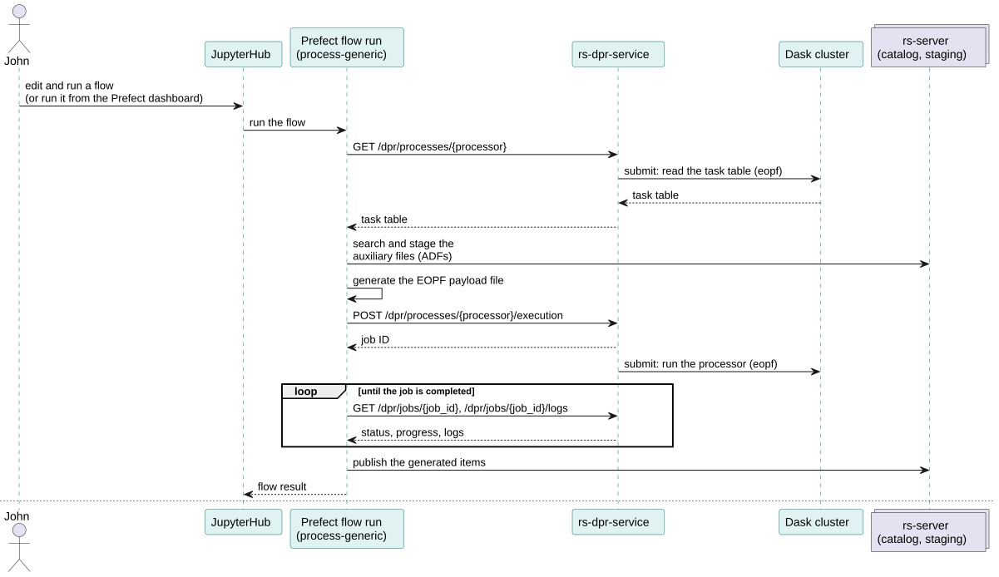

# Customise the DPR processing

All the DPR processors are run by the generic processing flow, **`process-generic`**: a Prefect flow able to
generate Copernicus products from any DPR processor, with no code specific to a mission or a processing level. The
mission flows only compute its parameters and call it: either directly from their default settings (e.g.
`process-s3-l0`), or through the `process-any` flow (e.g. `process-s3-l1-olci-ondemand`).

This page describes the parameters of `process-generic`, the default settings of the mission flows and of
`process-any`, and the storage configuration. How the payload of the processor is built from these parameters is described in
[Task tables and payload file](../flows/tasktable-payload.md), and how the processor is run in
[DPR processors](https://github.com/RS-PYTHON/rs-dpr-service/blob/develop/docs/doc/index.md).



## Parameters of `process-generic`

The flow takes a `dpr_input` parameter (`DprProcessIn`) and an optional `retry_config` (`staging_retries`,
`staging_retry_delay`: retries of the staging of the auxiliary files).

| Parameter | Mandatory | Description |
|---|---|---|
| `env` | Yes | Flow environment, see [Prefect flows](../flows/index.md#common-parameters). The `owner_id` is the owner of the generated products and of the API key used. |
| `processor_name` | Yes | Name of the processor, as a process of rs-dpr-service: `s1_l0`, `s3_l0`, `s1_ard`, `s3_l1olci`, `s3_l2olci`... |
| `processor_version` | Yes | Version of the processor (informative, used for the performance indicators). |
| `pipeline` or `unit` | One of them | Name of the pipeline of the task table to run (usual case), or of a single unit (advanced use). |
| `dask_cluster_label` | Yes | Label of the Dask cluster where the processor runs, see [Dask](https://github.com/RS-PYTHON/rs-documentation/blob/develop/docs/services/virtual-environment/dask.md). |
| `dask_cluster_instance` | No | Identifier of a specific Dask cluster instance, used to log the direct URL of its dashboard. |
| `s3_payload_file` | Yes | S3 path where the payload file is written (deleted after the run). |
| `input_products` | Yes | The input products: list of `{name, item_id, collection_name}`, where `name` is the input name in the task table, and `item_id` and `collection_name` identify the STAC item in the catalog. |
| `generated_product_to_collection_identifier` | Yes | Where to publish the generated products, see [Generated products](#generated-products). |
| `auxiliary_product_to_collection_identifier` | Yes | Where to find and stage the auxiliary files, see [Auxiliary files](#auxiliary-files). |
| `processing_mode` | No | Processing modes, used to filter the inputs and ADFs of the task table: `nrt`, `ntc`, `reprocessing`, `subs`. `always` is always applied. |
| `workflow_type` | No | `on-demand` (default), `systematic` or `benchmarking`. |
| `priority` | No | `low` (default), `medium` or `high`: priority of the tasks in the Dask cluster. |
| `start_datetime`, `end_datetime` | No | Time interval used to find the auxiliary files, usually the sensing start and stop of the input products. For the Level-0 processing, the input is a session without sensing dates: its publication date is used for both. |
| `satellite` | No | Satellite, e.g. `sentinel-3a`, used by the queries that depend on the satellite. |
| `reference_date`, `instrument_mode` | No | Other external variables, used by some task tables. |
| `edh_api_key` | No | [EarthDataHub](https://earthdatahub.destine.eu/) API key, to read the Copernicus DEM. |
| `temporary_folder`, `temporary_shared`, `dask_task_timeout` | No | Advanced options of the processor run. |

The logging level of the processor is given by `env.logging_level`.

### Generated products

`generated_product_to_collection_identifier` is a list of mappings:

```json
[
  {"name": "S03OLCEFR", "product_type": "S03OLCEFR", "collection_name": "s03olcefr"},
  {"name": "S03OLCERR", "product_type": "S03OLCERR"},
  {"name": "S03ISPS", "product_type": "*", "collection_name": "s3-l0"}
]
```

- `name` is the name of the output in the task table,
- if `collection_name` is not given, the collection is named after the product type,
- `product_type` can be `*`: all the product types are mapped to the same collection, which is then mandatory,
- the list can contain more elements than the outputs of the task table, so the same mapping can be used for
  several pipelines.

### Auxiliary files

`auxiliary_product_to_collection_identifier` is a list of mappings that give, for each auxiliary product type, where
to search the files (`source`) and in which catalog collection to stage them:

```json
[
  {"product_type": "AX___FRO_AX", "collection_name": "s03-aux-fro"},
  {"product_type": "ADF_OLCAL", "collection_name": "adf-olci", "source": "catalog"},
  {"product_type": "*", "collection_name": "s03-aux"}
]
```

- `source` is `auxip` (default), `catalog`, `prip`, `cadip`, `cdse` or `earthdatahub`. With `catalog`, the files
  are already in the catalog (e.g. ADFs converted to Zarr by the [conversion flows](../flows/common-flows.md#conversion-flows))
  and are not staged again,
- `product_type` can be `*` for all the other product types,
- if a product type is not mapped and there is no `*`, the collection `<satellite>-aux-<product_type>` is used with
  the `auxip` source,
- `selected_assets` (optional) stages only some assets of the items,
- the list can contain more elements than the ADFs of the task table.

## Default settings of the processing flows

The mission flows that don't use `process-any` (`process-l0`, `process-s1-l0`, `process-s3-l0`, `process-s1-ard`...)
read their default parameters from the `s<mission>-processing-default-setting`
[Prefect variable](https://docs.prefect.io/v3/concepts/variables), e.g. `s3-processing-default-setting`. It contains
a `common` section, merged with one section per processing (`l0`, `l1ard`...):

```json
{
  "common": {
    "owner_identifier": "copernicus",
    "priority": "low",
    "workflow": "systematic",
    "processing_mode": ["always"]
  },
  "l0": {
    "pipeline": "s3_l0_full",
    "processor": {"name": "s3_l0", "version": "<version>"},
    "dask_cluster_name": "<dask cluster label>",
    "session_collection": "<collection of the staged sessions>",
    "cadip_collections": ["<cadip collection>"],
    "auxiliary_product_to_collection_identifier": [],
    "generated_product_to_collection_identifier": [
      {"name": "S03OLCL0_", "product_type": "S03OLCL0_", "collection_name": "s03olcl0_"},
      {"name": "S03NATL0_", "product_type": "S03NATL0_", "collection_name": "s03natl0_"}
    ]
  }
}
```

The sections can also contain the processing-specific parameters, e.g. `session_collection` and
`cadip_collections` for the Level-0. The `flow_params` parameter of the mission flows overrides any of these values
for one run. When the unified variable doesn't exist, the flows read the legacy `s<mission>-l<level>-default-setting`
variables. `process-s3-l0` emits an event for each generated product, that starts the next processing when the
`workflow` is `systematic`, see [Systematic processing](systematic-processing.md#product-events).

### Default settings of `process-any`

The `process-any` flow (`env_args`, `input_products`, `external_variables`, `processing_id`, `workflow`) runs a
processor with the input products and external variables computed by the calling flow (see e.g. the
[Sentinel-3 flows](../flows/sentinel3-flows.md#olci-processing-flows)), and the other parameters read from the
`<processing_id>-default-setting` Prefect variable: `s3l1olci-default-setting` or `s3l2olci-default-setting`.
This variable is checked against the
[ProcessorDefaultSettings.schema.json](https://github.com/RS-PYTHON/rs-client-libraries/blob/develop/config/ProcessorDefaultSettings.schema.json)
JSON schema:

| Field | Mandatory | Description |
|---|---|---|
| `processor` | Yes | `name` and `version` of the processor. |
| `pipeline` or `unit` | Yes (one of them) | The pipeline or the unit of the task table to run. |
| `priority` | Yes | `low`, `medium` or `high`. |
| `processing_mode` | Yes | List of processing modes, e.g. `["always"]`. |
| `dask_cluster_name` | Yes | Label of the Dask cluster of the processor. |
| `auxiliary_product_to_collection_identifier` | Yes | ADFs to stage: `product_type`, `collection_name` and optional `source`, as above. |
| `generated_product_to_collection_identifier` | Yes | Generated products: `name`, `product_type` and `collection_name`. |

```json
{
  "processor": {"name": "s3_l1olci", "version": "<version>"},
  "pipeline": "ol1_eo",
  "priority": "low",
  "processing_mode": ["always"],
  "dask_cluster_name": "<dask cluster label>",
  "auxiliary_product_to_collection_identifier": [
    {"product_type": "AX___OSF_AX", "collection_name": "ax___osf_ax"}
  ],
  "generated_product_to_collection_identifier": [
    {"name": "S03OLCEFR", "product_type": "S03OLCEFR", "collection_name": "s03olcefr"}
  ]
}
```

Before running the processor, `process-any` checks that its Dask cluster and the `dask-staging` cluster are running.
It emits an event for each generated product, related to the `workflow`: only the events of a `systematic`
workflow start the next processing, see [Systematic processing](systematic-processing.md#product-events). It returns
the STAC items of the generated products.

### Write a flow based on `process-any`

A flow based on `process-any` only contains what is specific to its processor: a function that computes the input
products and the external variables of the processor from the STAC item of the product to process, and calls
`process-any` (the Sentinel-3 OLCI flows call it through `process_olci()`, that also requests the quicklooks). The
identifier of the processor is added to `ProcessingId`, and its settings to the `<identifier>-default-setting`
variable. The on-demand and systematic flows then only call the helpers of `rs_workflows.process_any_flow`:

```python
from functools import partial

from prefect import flow

from rs_workflows.flow_utils import FlowEnvArgs, FlowInputProduct, WorkflowType
from rs_workflows.process_any_flow import (
    FlowInputItem,
    ProcessingId,
    process_any,
    process_catalog_product,
    process_event_product,
)


async def process_my_product(env_args, item_id, collection_name, properties, workflow, base_name="MY_INPUT"):
    """Run my processor on a product."""
    return await process_any(
        env_args=env_args,
        input_products=[FlowInputProduct(name=base_name, item_id=item_id, collection_name=collection_name)],
        external_variables={"start_datetime": properties["start_datetime"], "end_datetime": properties["end_datetime"]},
        processing_id=ProcessingId.MY_PROCESSOR,
        workflow=workflow,
    )


@flow(name="process-my-product-ondemand")
async def process_my_product_ondemand(env_args: FlowEnvArgs, single_input_product: FlowInputItem,
                                      force_systematic: bool = False, base_name: str = "MY_INPUT"):
    """Read the product from the catalog and process it."""
    return await process_catalog_product(
        env_args, single_input_product, force_systematic, partial(process_my_product, base_name=base_name),
    )


@flow(name="process-my-product-systematic")
async def process_my_product_systematic(payload: dict):
    """Process the product of a product.<product type>.generated event."""
    return await process_event_product(payload, process_my_product)
```

The systematic flow is then started by an automation on the events of the input product type, see
[Add a step to the chain](systematic-processing.md#add-a-step-to-the-chain).

## Storage configuration

The `processing-storage-configuration` Prefect variable tells where the processors read and write the products: in
the S3 object storage, or on disks mounted on the Dask workers (e.g. for intermediate products). It is initialised by
the administrators from the [template](https://github.com/RS-PYTHON/rs-client-libraries/blob/develop/config/storage_configuration.json)
delivered with rs-client-libraries (see
[Initialise the processing environment](https://github.com/RS-PYTHON/rs-documentation/blob/develop/docs/administration/init-processing-environment.md)).

```json
{
  "product": {
    "default": {
      "adfs": {"storage": "s3"},
      "unit": [
        {"section": "input_products", "storage": "s3"},
        {"section": "output_products", "storage": "s3"}
      ],
      "pipeline": [
        {"section": "pipeline_input", "storage": "s3"},
        {"section": "pipeline_output", "storage": "s3"},
        {"section": "other", "storage": "shared-disk"}
      ]
    },
    "specific": [
      {"product_name": "DEM-SENTINEL-1", "storage": "s3-dem"}
    ]
  },
  "storage_configuration": [
    {
      "name": "s3", "kind": "obs", "opening_mode": "CREATE_OVERWRITE",
      "storage_options": {"key": "${S3_ACCESSKEY}", "secret": "${S3_SECRETKEY}",
                          "endpoint_url": "${S3_ENDPOINT}", "region_name": "${S3_REGION}"}
    },
    {
      "name": "s3-dem", "kind": "obs",
      "storage_options": {"key": "${S3_DEMS1_ACCESSKEY}", "secret": "${S3_DEMS1_SECRETKEY}",
                          "endpoint_url": "${S3_DEMS1_ENDPOINT}", "region_name": "${S3_DEMS1_REGION}"}
    },
    {"name": "shared-disk", "kind": "shared_disk", "opening_mode": "CREATE_OVERWRITE", "absolute_path": "/mnt/share/",
     "autoclean": true}
  ]
}
```

- `product.default` gives the storage of the ADFs, of the inputs and outputs of a unit (unit mode), and of the
  inputs, outputs and intermediate (`other`) products of a pipeline (pipeline mode).
- `product.specific` gives the storage of specific products, by their name in the task table.
- `storage_configuration` defines each storage:
    - `obs`: an S3 object storage, whose credentials (`${...}`) are read from the environment variables of the
      Prefect blocks of the user (see [Authentication](../flows/authentication.md#authentication-to-the-object-storage)),
    - `shared_disk`: a volume shared by the Dask workers, mounted under `absolute_path`; a unique folder is created for
      each run, and deleted after the run if `autoclean` is `true`. The payload files of the processors are also
      written on the first shared disk,
    - `local_disk`: a local folder of the Dask workers.

The output products written in the object storage are stored in the bucket given by the
[bucket configuration](https://github.com/RS-PYTHON/rs-documentation/blob/develop/docs/administration/update-rs-server.md#object-storage-buckets-and-data-lifecycle).

## Call the generic flow from your own flow

Use the `call_dpr_flow` helper of `rs_workflows.utils.dpr`, that builds the `DprProcessIn` parameters and calls
`process-generic`:

```python
from rs_workflows.flow_utils import FlowEnvArgs, FlowInputProduct
from rs_workflows.utils.dpr import call_dpr_flow

products = await call_dpr_flow(
    FlowEnvArgs(owner_id="my-login"),
    input_products=[FlowInputProduct(name="S3OLCIL0_1", item_id="<item id>", collection_name="s3-l0"), ...],
    external_variables={"start_datetime": start, "end_datetime": end, "satellite": "sentinel-3a"},
    dask_cluster_label="<dask cluster label>",
    processor_name="s3_l1olci",
    processor_version="<version>",
    pipeline="ol1_eo",
    unit=None,
    priority="low",
    processing_mode=["always"],
    workflow="on-demand",
    generated_product_to_collection_identifier=[...],
    auxiliary_product_to_collection_identifier=[...],
)
```

To cancel a running processor, see
[Cancel a DPR run](https://github.com/RS-PYTHON/rs-dpr-service/blob/develop/docs/doc/cancel-dpr-run.md).
