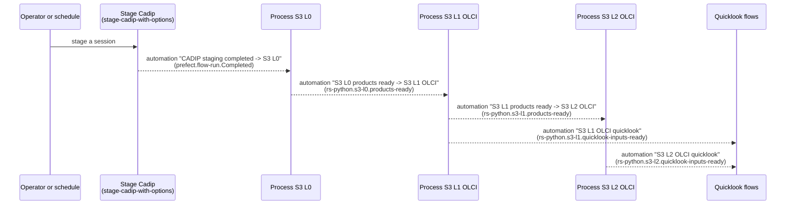

# Systematic processing

In **on-demand** processing, a user runs a flow with its parameters. In **systematic** processing, the flows are
started automatically when new data is available, so that the products are generated as soon as possible without
any human action. RS-Python implements the systematic processing with
[Prefect events and automations](https://docs.prefect.io/v3/concepts/automations): each processing flow emits an
event when its products are published, and an automation starts the next flow of the chain when it receives the
event.

The same flows are used for both kinds of processing: the systematic chain only adds the automations, deployed by
[rs-workflow-deployment](https://github.com/RS-PYTHON/rs-workflow-deployment/blob/develop/README.md). The
`workflow` parameter of the flows (`systematic` or `on-demand`) is recorded with the
[performance indicators](../operation/performance-indicators.md).

## Sentinel-3 chain



| Automation | Trigger | Action |
|---|---|---|
| CADIP staging completed -> S3 L0 | A flow run of the `Stage Cadip` deployment is completed. | Run `Process S3 L0` with the staged session. |
| S3 L0 products ready -> S3 L1 OLCI | Event `rs-python.s3-l0.products-ready`. | Run `Process S3 L1 OLCI` with the Level-0 products of the event. |
| S3 L1 products ready -> S3 L2 OLCI | Event `rs-python.s3-l1.products-ready`. | Run `Process S3 L2 OLCI` with the `S03OLCEFR` products of the event. |
| S3 L1 OLCI quicklook on quicklook-inputs-ready | Event `rs-python.s3-l1.quicklook-inputs-ready`. | Run `S3L1 OLCI quicklook` with the published items of the event. |
| S3 L2 OLCI quicklook on quicklook-inputs-ready | Event `rs-python.s3-l2.quicklook-inputs-ready`. | Run `S3L2 OLCI quicklook` with the published items of the event. |

The other parameters of the flows are read from their [default settings](customise-dpr-flow.md#default-settings-of-the-processing-flows).

## Events

The events are emitted with [`emit_event`](https://docs.prefect.io/v3/concepts/events) at the end of the flows.
Their name follows the `rs-python.<mission>-<level>.<what>` pattern, e.g. `rs-python.s3-l0.products-ready`
(`products_ready_event_name()` in `rs_workflows.on_demand.common.events`). Because the Prefect event payloads are
limited in size, they only contain the product types and identifiers, not the complete STAC items:

```json
{
  "event": "rs-python.s3-l0.products-ready",
  "resource": {
    "prefect.resource.id": "rs-python.s3-l0-result.<flow run id>",
    "prefect.resource.name": "S3A_20260807020505053186",
    "rs-python.session-id": "S3A_20260807020505053186"
  },
  "related": [{"prefect.resource.id": "prefect.flow-run.<flow run id>", "prefect.resource.role": "flow-run"}],
  "payload": {
    "flow_run_id": "<flow run id>",
    "session_id": "S3A_20260807020505053186",
    "products": [{"S03OLCL0_": "<item id>"}, {"S03NATL0_": "<item id>"}]
  }
}
```

The events and the automations runs are visible in the *Event feed* and *Automations* pages of the Prefect
dashboard.

## Add a step to the chain

1. Emit an event at the end of the upstream flow, with the information needed by the next one in its payload.
2. Write the downstream flow so that it accepts this information as parameters (see e.g. the `l0_products`
   parameter of `process-s3-l1-olci`).
3. Add an automation that matches the event and runs the deployment of the downstream flow, with its parameters
   rendered from the event with [Jinja templates](https://docs.prefect.io/v3/concepts/automations#templating-with-jinja),
   in [rs-workflow-deployment](https://github.com/RS-PYTHON/rs-workflow-deployment/blob/develop/README.md).
