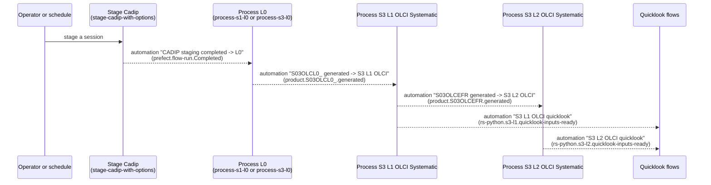

# Systematic processing

In **on-demand** processing, a user runs a flow with its parameters. In **systematic** processing, the flows are
started automatically when new data is available, so that the products are generated as soon as possible without
any human action. RS-Python implements the systematic processing with
[Prefect events and automations](https://docs.prefect.io/v3/concepts/automations): each processing flow emits an
event when its products are published, and an automation starts the next flow of the chain when it receives the
event.

Both kinds of processing run the same code: the OLCI processing has an on-demand flow and a systematic flow, that
only differ by how they get their input product (from their parameters or from the event that started them), and
the systematic chain adds the automations, deployed by
[rs-workflow-deployment](https://github.com/RS-PYTHON/rs-workflow-deployment/blob/develop/README.md). The
`workflow` of the processing (`systematic` or `on-demand`) is recorded with the
[performance indicators](../operation/performance-indicators.md).

## Level-0 and Sentinel-3 chain

The Level-0 processing of the Sentinel-1 and Sentinel-3 sessions is started the same way after their staging: the
automation runs `Process L0` (`process-l0`), which runs the Level-0 flow of the mission of the session
(`process-s1-l0` or `process-s3-l0`) as a sub-flow. The Sentinel-3 products are then processed by the OLCI chain;
the Sentinel-1 Level-0 products are not processed further by the systematic processing yet.



| Automation | Trigger | Action |
|---|---|---|
| CADIP staging completed -> L0 | A flow run of the `Stage Cadip` deployment is completed. | Run `Process L0` (`process-l0`) with the staged session, the owner of the staging with `process.force_systematic` set in `env_args`: it runs `process-s1-l0` or `process-s3-l0` according to the mission of the session. |
| S03OLCL0_ generated -> S3 L1 OLCI | Event `product.S03OLCL0_.generated` of a `systematic` workflow. | Run `Process S3 L1 OLCI Systematic` (`process-s3-l1-olci-systematic`) with the payload of the event. |
| S03OLCEFR generated -> S3 L2 OLCI | Event `product.S03OLCEFR.generated` of a `systematic` workflow. | Run `Process S3 L2 OLCI Systematic` (`process-s3-l2-olci-systematic`) with the payload of the event. |
| S3 L1 OLCI quicklook on quicklook-inputs-ready | Event `rs-python.s3-l1.quicklook-inputs-ready`. | Run `S3L1 OLCI quicklook` with the published items of the event. |
| S3 L2 OLCI quicklook on quicklook-inputs-ready | Event `rs-python.s3-l2.quicklook-inputs-ready`. | Run `S3L2 OLCI quicklook` with the published items of the event. |

The automation runs `process-l0` with the owner (`env`) of the staging flow as `env_args`, with `process.force_systematic` set. The flows
read their other parameters from the [default settings](customise-dpr-flow.md#default-settings-of-the-processing-flows)
of their processing.

The OLCI processing is run for each `S03OLCL0_` product generated by the Level-0, then for each `S03OLCEFR`
product generated by the Level-1: the products generated by a systematic run are processed one by one by the next
processing of the chain, as soon as they are published.

## Events

The events are emitted with [`emit_event`](https://docs.prefect.io/v3/concepts/events) at the end of the flows.
The events and the automations runs are visible in the *Event feed* and *Automations* pages of the Prefect
dashboard.

### Product events

A processing flow emits a `product.<product type>.generated` event for each generated product
(`emit_product_generated_events()` in `rs_workflows.on_demand.common.events`, called by `call_dpr_flow()` in
`rs_workflows.utils.dpr`). The event is related to the `workflow` of the processing (`on-demand`,
`systematic`...), and the automations only match the events of a `systematic` workflow (`match_related` on the
`workflow` role): they start the systematic flow of the next processing for this product. So an on-demand processing
only generates its own products, unless it is run with `env_args.process.force_systematic`, to start the rest of the chain from a
given product (the automation that runs `process-l0` after the staging of a session sets it).

The event is also related to the flow run that generated the product, and to the `processing` and platform (e.g.
`sentinel-3a`) tags; the platform tag is only added when the STAC item has a `platform` property, and no event is
emitted for a product without `product:type`. Because the Prefect event payloads are limited in size, its payload only contains the owner and
the STAC item of the product without its assets and links, used by the next flow to compute its inputs:

```json
{
  "event": "product.S03OLCL0_.generated",
  "resource": {"prefect.resource.id": "prefect.flow-run.<flow run id>", "prefect.resource.name": "S03OLCL0_"},
  "related": [
    {"prefect.resource.id": "systematic", "prefect.resource.role": "workflow"},
    {"prefect.resource.id": "prefect.tag.processing", "prefect.resource.role": "tag"},
    {"prefect.resource.id": "prefect.tag.sentinel-3a", "prefect.resource.role": "tag"}
  ],
  "payload": {
    "owner_id": "copernicus",
    "product": {
      "id": "<item id>",
      "geometry": {"type": "Polygon", "coordinates": ["..."]},
      "collection": "s03olcl0_",
      "properties": {"product:type": "S03OLCL0_", "platform": "sentinel-3a", "start_datetime": "...", "end_datetime": "..."}
    }
  }
}
```

### Quicklook events

The OLCI flows also emit, in on-demand and systematic processing, a `rs-python.s3-<level>.quicklook-inputs-ready`
event with the catalog references of all their generated products, that starts the generation of their quicklooks:

```json
{
  "event": "rs-python.s3-l1.quicklook-inputs-ready",
  "resource": {"prefect.resource.id": "rs-python.s3-l1-result.<flow run id>", "prefect.resource.name": "S3 OLCI L1 products"},
  "related": [{"prefect.resource.id": "prefect.flow-run.<flow run id>", "prefect.resource.role": "flow-run"}],
  "payload": {
    "owner_id": "copernicus",
    "published_items": [{"id": "<item id>", "collection": "s03olcefr"}, {"id": "<item id>", "collection": "s03olcerr"}]
  }
}
```

## Add a step to the chain

1. Make the upstream flow emit an event with the information needed by the next one in its payload, e.g. by running
   its processor with `call_dpr_flow()`, that emits the [product events](#product-events) of the generated products.
2. Write the downstream flow so that it accepts this information as parameters (see e.g. the `payload` parameter of
   `process-s3-l1-olci-systematic`).
3. Add an automation that matches the event and runs the deployment of the downstream flow, with its parameters
   rendered from the event with [Jinja templates](https://docs.prefect.io/v3/concepts/automations#templating-with-jinja),
   in [rs-workflow-deployment](https://github.com/RS-PYTHON/rs-workflow-deployment/blob/develop/README.md).
