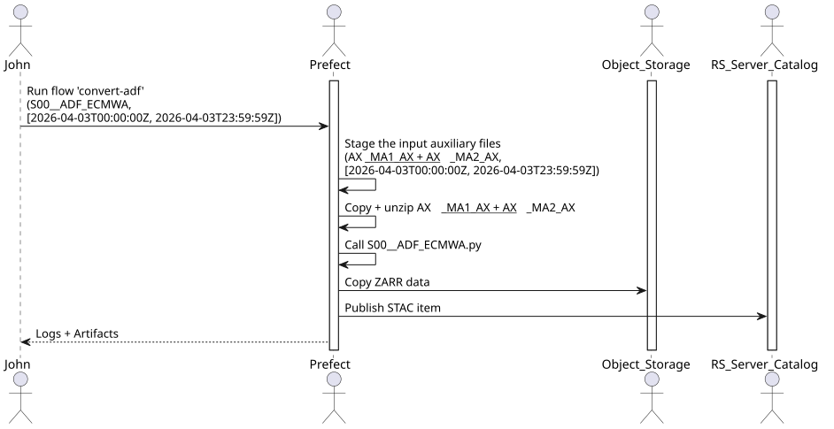

# Common flows

This page describes the flows that are not specific to a mission: search, staging, conversion, operation and
benchmarking. The processing flows are described in [Level-0 flows](level0-flows.md), the mission pages and
[Customise the DPR processing](../advanced/customise-dpr-flow.md). The source code of the flows is in
[rs_workflows](https://github.com/RS-PYTHON/rs-client-libraries/tree/develop/rs_workflows).

The `env` parameter of the flows is described in [Prefect flows](index.md#common-parameters).

## Search flows

These flows search products and return a STAC `ItemCollection`. They are mainly used as sub-flows, or to test a
filter before running a staging or a processing.

| Flow | Parameters | Description |
|---|---|---|
| `search-cadip` | `cadip_collection_identifier`, `session_identifier`, `error_if_empty` | Search a session in a CADIP collection (e.g. `s1_ins` for the Sentinel-1 sessions of a station). |
| `search-aux` | `aux_cql2`, `source`, `error_if_empty` | Search auxiliary files with a CQL2 filter, in a source: `auxip` (default), `catalog`, `prip`, `cadip`, `cdse` or `earthdatahub`. |
| `search-prip` | `prip_cql2`, `prip_collection`, `error_if_empty` | Search products in the PRIP stations with a CQL2 filter. |
| `search-catalog` | `catalog_cql2`, `collections`, `error_if_empty` | Search items in the catalog with a CQL2 filter. |
| `search-earthdatahub` | `edh_cql2`, `error_if_empty` | Search products in the [EarthDataHub](https://earthdatahub.destine.eu/) of [Destination Earth](https://destination-earth.eu/). |

The CQL2 filters are given in JSON, e.g.:

```json
{"op": "and", "args": [
  {"op": "=", "args": [{"property": "product:type"}, "AUX_PP1"]},
  {"op": "t_intersects", "args": [{"property": "datetime"}, {"interval": ["2026-08-01T00:00:00Z", "2026-08-02T00:00:00Z"]}]}
]}
```

## Staging flows

These flows copy products from the external data sources into the catalog, with the
[staging service](https://github.com/RS-PYTHON/rs-server/blob/develop/docs/doc/users/staging.md).

| Flow | Parameters | Description |
|---|---|---|
| `stage-generic` | `stac_input`, `catalog_collection_identifier`, `asset_names` | Stage any STAC items: a `Feature` or `FeatureCollection` (e.g. the result of a search flow), or a URL that returns a `FeatureCollection`. |
| `stage-cadip-with-options` | `cadip_collection_identifier`, `session_identifier`, `catalog_collection_identifier`, `staging_retries`, `staging_retry_delay` | Search a CADIP session and stage it, with retries. |
| `stage-cadip-latest` | `cadip_collection`, `owner_identifier` | Stage the latest session of a CADIP station (searched over the last 10 hours). |
| `stage-cadip-selection` | `cadip_collection`, `owner_identifier` | Search the sessions of the last 10 hours of a CADIP station, ask the user to select one, and stage it. |
| `stage-aux` | `start_datetime`, `end_datetime`, `product_type`, `catalog_collection_identifier` | Stage the auxiliary files of a type that cover a time interval (`ValCover` policy). |
| `stage-aux-cql2` | `cql2_filter`, `catalog_collection_identifier`, `timeout_seconds`, `source`, `selected_assets` | Search auxiliary files with a CQL2 filter in a source (see `search-aux`) and stage the ones that are not already in the catalog. Used by the processing flows to stage the ADFs. |
| `stage-prip` | `start_datetime`, `end_datetime`, `product_type`, `prip_collection`, `catalog_collection_identifier` | Stage the PRIP products of a type in a time interval. |

The items already in the catalog are not staged again.

## Conversion flows

These flows convert legacy products and auxiliary files into the [Zarr](https://zarr.dev/) format used by the EOPF
processors.

| Flow | Parameters | Description |
|---|---|---|
| `convert-adf` | `adf_input`: ADF type, time interval, satellite or CQL2 filter, collections mapping | Stage the legacy auxiliary files needed to build an ADF of the given type, convert them to Zarr, store the result in the object storage and publish it in the catalog. |
| `convert-adf-group` | `period_start_datetime`, `period_end_datetime`, `configuration`, `owner` | Convert a set of ADF types over a period: the past part of the period is converted immediately, the future part is scheduled with `convert-adf-scheduled`. A sample configuration is given in [convert-aux-sample.json](https://github.com/RS-PYTHON/rs-client-libraries/blob/develop/rs_workflows/on_demand/adf/config/convert-aux-sample.json). |
| `convert-adf-scheduled` | `adf_type`, `cql2_filter_without_date`, `period`, `auxiliary_product_to_collection_identifier` | Convert the ADFs of the last period, started by a schedule. |
| `import-adf-from-obs` | `configuration`, `owner`, `obs_id`, `rehearsal_mode` | Import ADF files already in Zarr format from an object storage bucket into the catalog. |
| `convert-safe` | `conversion_input` | Stage a legacy SAFE product, convert it to its EOPF Zarr counterpart with the `conv_safe_zarr` process of [rs-dpr-service](https://github.com/RS-PYTHON/rs-dpr-service/blob/develop/docs/doc/index.md), and publish it. |



## Operation flows

These flows are run by the operators, from the `monitoring-k8s-pool` work pool. They run on behalf of technical
users (`operator-osam`, `operator-quota`), whose Prefect blocks must be initialised.

| Flow | Parameters | Description |
|---|---|---|
| `synchronize-osam-accounts` | | Synchronise the object storage accounts with the Keycloak accounts, see [OSAM](https://github.com/RS-PYTHON/rs-server/blob/develop/docs/doc/users/osam.md). |
| `update-osam-account` | `user_name` | Apply the object storage rights of a user. Publishes the `obs-rights` artifact. |
| `initialize-obs-db` | | Create the tables of the object storage quota monitoring database. |
| `collect-obs-logs` | `platform`, `max_files`, `threshold_minute` | Collect the object storage access logs, see [Object storage quota monitoring](../operation/quota-monitoring.md). |
| `consolidate-obs-logs` | `retention_hours` | Consolidate the old access logs per user, bucket and hour. |
| `initialize-pi-db` | | Create the tables of the [performance indicators](../operation/performance-indicators.md) database. |
| `cleanup-offline-workers` | `work_pools_csv`, `max_age_days` | Delete the Prefect workers that are offline for more than `max_age_days`. Scheduled every day. |

## Benchmarking

The `benchmark-processor` flow (`processor_name`, `processor_version`, `scenario_name`) reads its settings from the
`benchmarking-<processor_name>-settings` Prefect variable and publishes the `benchmarking-result` artifact. Its
implementation is a mockup.
