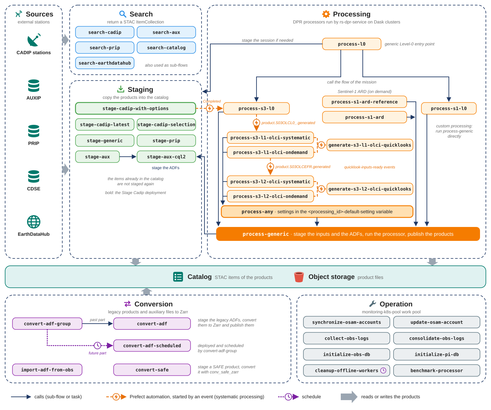

# Prefect flows

The `rs_workflows` package of rs-client-libraries implements the [Prefect](https://www.prefect.io/) flows delivered
with RS-Python. They search, stage and process the Sentinel products by calling the RS-Python services with the
[rs_client](../index.md) library. Their source code is in the
[rs_workflows](https://github.com/RS-PYTHON/rs-client-libraries/tree/develop/rs_workflows) folder.

To run them, see [Run existing flows](https://github.com/RS-PYTHON/rs-documentation/blob/develop/docs/getting-started/run-existing-flows.md).
To learn more about Prefect, see the [Prefect documentation](https://docs.prefect.io/v3/get-started) and
[Prefect](https://github.com/RS-PYTHON/rs-documentation/blob/develop/docs/services/virtual-environment/prefect.md).

## Overview

The search and staging flows bring the products of the external stations into the catalog. The processing flows
generate new products from them with the DPR processors, through the generic flow `process-generic`, which also
stages the auxiliary files (ADFs) they need. The flows based on `process-any` read their settings from a Prefect
variable per processor, and `process-any` emits an event for each generated product. The Sentinel-3 flows are
chained automatically by Prefect automations, see [Systematic processing](../advanced/systematic-processing.md). The conversion flows convert the legacy products
and auxiliary files to Zarr, and the operation flows maintain the platform.

## Flow families

| Family | Flows | Documentation |
|---|---|---|
| Search | `search-cadip`, `search-aux`, `search-prip`, `search-catalog`, `search-earthdatahub` | [Common flows](common-flows.md#search-flows) |
| Staging | `stage-generic`, `stage-cadip-with-options`, `stage-cadip-latest`, `stage-cadip-selection`, `stage-aux`, `stage-aux-cql2`, `stage-prip` | [Common flows](common-flows.md#staging-flows) |
| Conversion | `convert-adf`, `convert-adf-group`, `convert-adf-scheduled`, `import-adf-from-obs`, `convert-safe` | [Common flows](common-flows.md#conversion-flows) |
| Generic processing | `process-generic`, `process-any` | [Customise the DPR processing](../advanced/customise-dpr-flow.md) |
| Level-0 processing | `process-l0`, `process-s1-l0`, `process-s3-l0` | [Level-0 flows](level0-flows.md) |
| Sentinel-1 processing | `process-s1-l0`, `process-s1-ard-reference`, `process-s1-ard` | [Sentinel-1 flows](sentinel1-flows.md) |
| Sentinel-2 processing | | [Sentinel-2 flows](sentinel2-flows.md) |
| Sentinel-3 processing | `process-s3-l0`, `process-s3-l1-olci`, `process-s3-l2-olci`, `process-s3-l1-olci-ondemand`, `process-s3-l1-olci-systematic`, `process-s3-l2-olci-ondemand`, `process-s3-l2-olci-systematic`, `generate-s3-l1-olci-quicklooks`, `generate-s3-l2-olci-quicklooks` | [Sentinel-3 flows](sentinel3-flows.md) |
| Operation | `synchronize-osam-accounts`, `update-osam-account`, `collect-obs-logs`, `consolidate-obs-logs`, `initialize-obs-db`, `initialize-pi-db`, `cleanup-offline-workers` | [Common flows](common-flows.md#operation-flows) |
| Benchmarking | `benchmark-processor` | [Common flows](common-flows.md#benchmarking) |

## Deployments

The flows are made runnable on the platform by [Prefect deployments](https://docs.prefect.io/v3/concepts/deployments),
created by [rs-workflow-deployment](https://github.com/RS-PYTHON/rs-workflow-deployment/blob/develop/README.md). The
deployments delivered by default are:

| Deployment | Flow | Tags | Work pool |
|---|---|---|---|
| Search Auxip | `search-aux` | searching, auxip | integrated |
| Search Cadip | `search-cadip` | searching, cadip | integrated |
| Search Catalog | `search-catalog` | searching, catalog | integrated |
| Search Prip | `search-prip` | searching, prip | integrated |
| Stage Generic | `stage-generic` | all, staging | integrated |
| Stage Aux | `stage-aux` | aux, staging | integrated |
| Stage Aux CQL2 | `stage-aux-cql2` | aux, staging | integrated |
| Stage Cadip | `stage-cadip-with-options` | cadip, staging | integrated |
| Stage Prip | `stage-prip` | prip, staging | integrated |
| Convert ADF | `convert-adf` | conversion, auxip, on-demand | integrated |
| Convert ADF Group | `convert-adf-group` | conversion, auxip, on-demand | integrated |
| Convert ADF Scheduled | `convert-adf-scheduled` | conversion, auxip | integrated |
| Convert SAFE | `convert-safe` | conversion, staging, on-demand | integrated |
| Process Generic | `process-generic` | all, processing | integrated |
| Process L0 | `process-l0` | l0, processing, s1, s2, s3 | integrated |
| Process S1 L0 | `process-s1-l0` | l0, processing, s1 | integrated |
| Process S1 ARD Reference | `process-s1-ard-reference` | l1, processing, s1, ard | integrated |
| Process S1 ARD | `process-s1-ard` | l1, processing, s1, ard | integrated |
| Process S3 L0 | `process-s3-l0` | l0, processing, s3 | integrated |
| Process S3 L1 OLCI | `process-s3-l1-olci` | l1, processing, s3, olci | integrated |
| Process S3 L2 OLCI | `process-s3-l2-olci` | l2, processing, s3, olci | integrated |
| S3L1 OLCI quicklook | `generate-s3-l1-olci-quicklooks` | l1, s3, olci, quicklook | integrated |
| S3L2 OLCI quicklook | `generate-s3-l2-olci-quicklooks` | l2, s3, olci, quicklook | integrated |
| Benchmark Processor | `benchmark-processor` | processing, all, benchmarking | integrated |
| Synchronize OSAM Accounts | `synchronize-osam-accounts` | operation, osam | monitoring |
| Update OSAM Account | `update-osam-account` | operation, osam | monitoring |
| Collect OBS Logs | `collect-obs-logs` | operation, obs | monitoring |
| Consolidate OBS Logs | `consolidate-obs-logs` | operation, obs | monitoring |
| Clean old prefect workers | `cleanup-offline-workers` | operation, prefect | monitoring (daily schedule) |

In the Prefect dashboard, a deployment is identified by `<flow name>/<deployment name>`, e.g.
`process-l0/Process L0`.

The automations that chain the processing flows are described in [Systematic processing](../advanced/systematic-processing.md).

## Naming conventions

To ease the operation, the flows, deployments, tags, work pools and artifacts follow these conventions:

| Object | Convention | Examples |
|---|---|---|
| Flow | `<verb>-<object>` in lower case, the verb being the kind of processing: `search`, `stage`, `process`, `convert`, `generate`... | `stage-cadip-with-options`, `process-s3-l1-olci` |
| Deployment | The flow name in plain words, capitalised. | `Stage Cadip`, `Process S3 L1 OLCI` |
| Tags | The kind of processing (`searching`, `staging`, `processing`, `conversion`, `operation`...), the source or mission (`cadip`, `auxip`, `prip`, `s1`, `s3`...), the level (`l0`, `l1`, `l2`) and the instrument (`olci`...). | `l1`, `processing`, `s3`, `olci` |
| Work pool | `<usage>-k8s-pool` | `processing-integrated-k8s-pool`, `processing-sandbox-k8s-pool`, `monitoring-k8s-pool` |
| Artifact | `<object>-<content>` in lower case | `dpr-task-table`, `dpr-payload`, `staging-result` |

## Common parameters

Most flows take an `env` parameter (`FlowEnvArgs`), with:

| Field | Description |
|---|---|
| `owner_id` | The user on behalf of whom the flow runs: its Prefect block `env-vars-<owner_id>` is read to get its API key and object storage credentials, and it is the default owner of the catalog collections. See [Authentication](authentication.md). |
| `logging_level` | Logging level of the flow, its tasks and the EOPF processors (`DEBUG`, `INFO`, `WARNING`, `ERROR`, `CRITICAL`). |
| `called_by` | Free text to trace who or what called the flow. |
| `calling_span` | Internal: OpenTelemetry span of the calling flow, to link the traces. |

The processing flows of a mission read their default parameters from a Prefect variable, so they can be run with
very few parameters, see [Customise the DPR processing](../advanced/customise-dpr-flow.md#default-settings-of-the-processing-flows).

## Artifacts

The flows publish [Prefect artifacts](https://docs.prefect.io/v3/concepts/artifacts) to help the investigations:

| Artifact | Published by | Content |
|---|---|---|
| `dpr-task-table` | `process-generic` | The task table of the processor. |
| `dpr-payload` | `process-generic` | The payload file sent to the processor (without the secrets). |
| `aux-cql2-filter` | `process-generic` | The CQL2 filters used to select the auxiliary files. |
| `auxiliary-stac-item` | `stage-aux-cql2` | The staged auxiliary items. |
| `dask-cluster-configuration` | processing flows | The configuration of the Dask cluster used. |
| `staging-result`, `monitoring-url` | staging of the Level-0 flows | The staged session and the links to monitor it. |
| `obs-rights` | `update-osam-account` | The object storage rights applied to the user. |
| `benchmarking-result` | `benchmark-processor` | The benchmarking results. |
