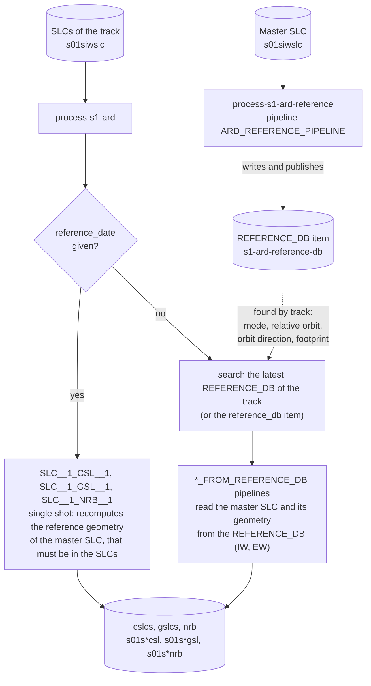
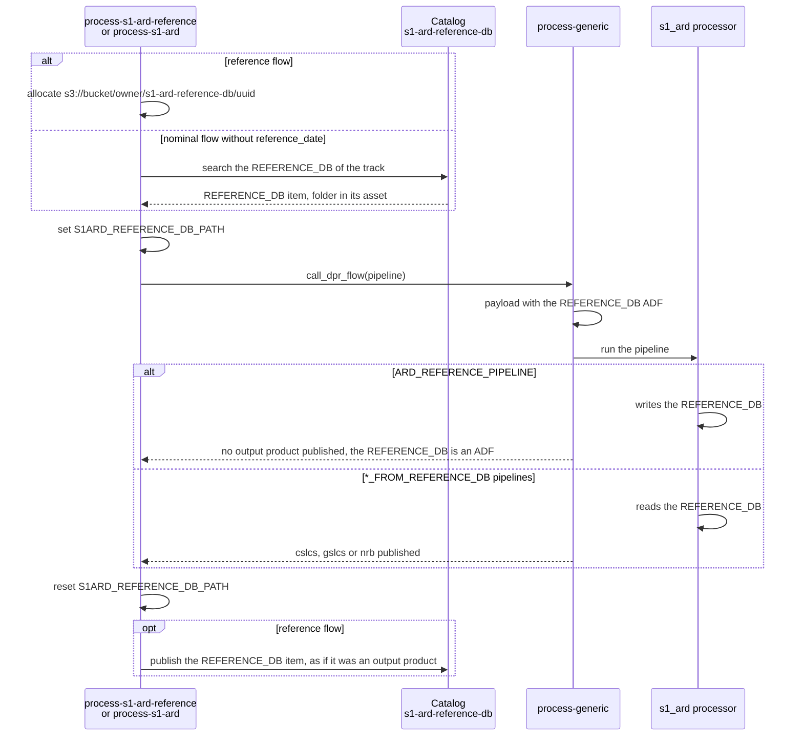

# Sentinel-1 flows

The [Sentinel-1](https://sentinels.copernicus.eu/web/sentinel/missions/sentinel-1) processing available in
RS-Python is:

| Processing | How to run it | Processor (rs-dpr-service process) |
|---|---|---|
| Level-0 | `process-l0` or `process-s1-l0` flows, see [Level-0 flows](level0-flows.md). The session is the only input product (`S1CADUS`). In systematic processing, it is started automatically after the staging of the session, see [Systematic processing](../advanced/systematic-processing.md). | `s1_l0` |
| Analysis Ready Data (ARD) | `process-s1-ard-reference` then `process-s1-ard` flows, see [Analysis Ready Data](#analysis-ready-data-ard). They can also be run with the `process-generic` flow, with the `s1_ard` processor and one of the pipelines of its task table, see [Customise the DPR processing](../advanced/customise-dpr-flow.md). | `s1_ard` |

The default settings of the Sentinel-1 flows are read from the `s1l0-default-setting` (Level-0) and
`s1ard-default-setting` (ARD) Prefect variables, see
[Customise the DPR processing](../advanced/customise-dpr-flow.md#default-settings-of-the-processing-flows).

The task tables of these processors, with their pipelines, inputs and auxiliary files, are in the
[rs-dpr-service config](https://github.com/RS-PYTHON/rs-dpr-service/tree/develop/config) folder
(`TaskTable_S1_L0_*.json`, `TaskTable_S1_ARD_*.json`). The Sentinel-1 ARD processor also needs a digital elevation
model, read from the [EarthDataHub](https://earthdatahub.destine.eu/) of [Destination Earth](https://destination-earth.eu/)
(`EDH_API_KEY` env var, see below).

## Analysis Ready Data (ARD)

The ARD processing generates products from Sentinel-1 SLC products (`IW`, `EW` or `SM` instrument mode), already
converted to Zarr and published in the catalog. The pipelines of the `s1_ard` task table are:

| Pipeline | Description | Output |
|---|---|---|
| `ARD_REFERENCE_PIPELINE` | Reference pipeline: computes the reference geometry of a master SLC and writes it in the `REFERENCE_DB`. | `REFERENCE_DB` |
| `SLC__1_CSL__1` | Co-registered SLC. | `cslcs` |
| `SLC__1_GSL__1` | Geocoded Single Look Complex. | `gslcs` |
| `SLC__1_NRB__1` | Normalised Radar Backscatter (mosaicked on the Sentinel-2 tiles, `S2_TILES` auxiliary file). | `nrb` |
| `SLC__1_CSL__1_FROM_REFERENCE_DB`, `SLC__1_GSL__1_FROM_REFERENCE_DB`, `SLC__1_NRB__1_FROM_REFERENCE_DB` | Same products, with the master SLC and its reference geometry read from the `REFERENCE_DB` (`IW` and `EW` only). | `cslcs`, `gslcs`, `nrb` |

These pipelines, except the `*_FROM_REFERENCE_DB` ones, are also available in the `DprPipeline` enum of `rs_client`
(`S1ARD_REF`, `S1ARD_CSL`, `S1ARD_GSL`, `S1ARD_NRB`).

The processor runs the `SLC__1_*` pipelines in two modes:

- **Single shot**, with a reference date: the master SLC of this date must be in the input SLCs, and the processor
  recomputes its reference geometry at each run. The `REFERENCE_DB` is not used. This is the mode of the
  `SLC__1_CSL__1`, `SLC__1_GSL__1` and `SLC__1_NRB__1` pipelines.
- **REFERENCE_DB**, without reference date: the processor reads the master SLC and its reference geometry from the
  `REFERENCE_DB` generated once by `ARD_REFERENCE_PIPELINE`. This is the mode of the `*_FROM_REFERENCE_DB` pipelines.
  It is only available for the `IW` and `EW` instrument modes: for `SM`, the processor requires a reference date.

The two flows work together through the `s1-ard-reference-db` catalog collection: the reference flow is run once per
track on a master SLC, then the nominal flow is run on the other SLCs of the track.

The flows are:

| Flow | Parameters | Description |
|---|---|---|
| `process-s1-ard-reference` | `slc`, `env_args`, `verbose` | Run once on a master SLC to generate the `REFERENCE_DB` used by the nominal flow, with the `ARD_REFERENCE_PIPELINE` pipeline. |
| `process-s1-ard` | `slcs`, `reference_date`, `env_args`, `pipeline`, `reference_db`, `verbose` | Nominal on-demand ARD processing of SLCs, with the given `pipeline` (`SLC__1_CSL__1`, `SLC__1_GSL__1` or `SLC__1_NRB__1`), or by default the pipeline of the settings. With a `reference_date`, the date of the master SLC, in single shot mode. Without `reference_date`, with the `REFERENCE_DB` of the catalog, see below. |

- `slc` and `slcs` are STAC item identifiers of the SLC products, searched in the `input_collections` of the
  settings (default: `s01sewslc`, `s01siwslc`, `s01ssmslc`). All the SLCs must share the same
  `sar:instrument_mode`, which is given to the processor as the `instrument_mode` external variable.
- The [EarthDataHub](https://earthdatahub.destine.eu/) API key, used to read the Copernicus DEM, is not a flow
  parameter, because the flow parameters can be read by everyone in the Prefect UI. It is read from the `EDH_API_KEY`
  env var of the `env-vars-<owner_id>` Prefect secret block of the `env_args.owner_id` user, or of the global
  `env-vars` block. Without it, the processing is not launched.
- Without `reference_date`, `process-s1-ard` runs the `<pipeline>_FROM_REFERENCE_DB` pipeline with the
  `REFERENCE_DB` of the `s1-ard-reference-db` collection whose item ID is given by `reference_db`, or by default the
  latest one (`created`) generated from a master SLC of the same track as the SLCs: same `sar:instrument_mode`,
  `sat:relative_orbit` and `sat:orbit_state` (if given), and intersecting the first SLC. All the SLCs must be on the
  same track, with a `sat:relative_orbit`. The flow fails if no `REFERENCE_DB` is found: run
  `process-s1-ard-reference` on a master SLC of the track first. For the `SLC__1_NRB__1` pipeline, the date of the
  first SLC is used to select the `S2_TILES` auxiliary file.
- The `ETAD` and `ORBIT` auxiliary files are staged once per input SLC (`folder_multiplicity: one_per_input` in the
  task table), see [Task table and payload](tasktable-payload.md#2-find-and-stage-the-auxiliary-files).

The `REFERENCE_DB` is handled specifically: it is never searched nor staged by the generic processing flow, the S1 ARD
flows give its folder to the processor themselves. For the `ARD_REFERENCE_PIPELINE`, the
`process-s1-ard-reference` flow allocates a new folder `s3://<bucket>/<owner>/s1-ard-reference-db/<uuid>` for it, the
bucket being given by the
[bucket configuration](https://github.com/RS-PYTHON/rs-documentation/blob/develop/docs/administration/update-rs-server.md#object-storage-buckets-and-data-lifecycle)
for the owner, the `s1-ard-reference-db` collection and the `ARD_REFERENCE_DB` product type. Its path is written in
the logs of the flow.

The `REFERENCE_DB` is not an output product of the task table, but it is the result of the reference pipeline: once
the processing is finished, the `process-s1-ard-reference` flow publishes it in the `s1-ard-reference-db` catalog
collection of the owner, as if it was an output product. Its item:

- has the `<uuid>` of its folder as ID, and the `ARD_REFERENCE_DB` product type (`product:type`),
- has the geometry, dates, platform, instrument mode and orbit (`sat:orbit_state`, `sat:relative_orbit`) of the
  master SLC, and a `derived_from` link to it,
- has a `REFERENCE_DB` asset, whose href is the folder of the `REFERENCE_DB`.

The `s1-ard-reference-db` collection must exist: the flow checks it before processing anything. The flow fails if the
catalog rejects the item, with the path of the generated `REFERENCE_DB` in the error.

The folder of the `REFERENCE_DB` is given to the generic processing flow (`process-generic`), that builds the payload
of the processor, by the `S1ARD_REFERENCE_DB_PATH` context variable of `on_demand_processing.py`: the S1 ARD flows
set it before calling the generic flow, which adds the `REFERENCE_DB` auxiliary file to the payload when it is set,
and reset it after.

