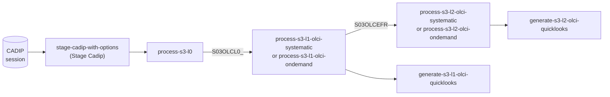

# Sentinel-3 flows

The [Sentinel-3](https://sentinels.copernicus.eu/web/sentinel/missions/sentinel-3) processing chain available in
RS-Python goes from the raw data sessions to the OLCI Level-2 products and their quicklooks:

| Flow | Parameters | Description | Processor |
|---|---|---|---|
| `process-s3-l0` | `session`, `flow_params`, `verbose` | Level-0 processing of a session already staged (see also `process-l0` in [Level-0 flows](level0-flows.md)). Emits a `product.<product type>.generated` event for each generated product, that starts the OLCI Level-1 processing when the workflow is `systematic`. | `s3_l0` |
| `process-s3-l1-olci-ondemand` | `env_args`, `single_input_product` (`item_id`, `collection_name`, `s03olcl0_` by default), `force_systematic`, `olcil0_base_name`, `navl0_base_name` | OLCI Level-1 processing of an `S03OLCL0_` product, run by a user. | `s3_l1olci` |
| `process-s3-l1-olci-systematic` | `payload` | OLCI Level-1 processing of the `S03OLCL0_` product of a `product.S03OLCL0_.generated` event, run by an automation. | `s3_l1olci` |
| `process-s3-l2-olci-ondemand` | `env_args`, `single_input_product` (`item_id`, `collection_name`, `s03olcefr` by default), `force_systematic`, `olcefr_base_name` | OLCI Level-2 processing of an `S03OLCEFR` product, run by a user. | `s3_l2olci` |
| `process-s3-l2-olci-systematic` | `payload` | OLCI Level-2 processing of the `S03OLCEFR` product of a `product.S03OLCEFR.generated` event, run by an automation. | `s3_l2olci` |
| `generate-s3-l1-olci-quicklooks` | `owner_id`, `published_items` | Generate an RGB quicklook of each Level-1 product, as a JPEG image and a georeferenced [Cloud Optimized GeoTIFF](https://cogeo.org/), upload them next to the product and add them as `thumbnail` assets of its STAC item. | |
| `generate-s3-l2-olci-quicklooks` | `owner_id`, `published_items` | Same for the Level-2 products. | |

The flows are chained automatically by Prefect automations, see
[Systematic processing](../advanced/systematic-processing.md). They can also be run individually from the Prefect
dashboard.

## OLCI processing flows

The OLCI Level-1 and Level-2 flows only compute the input products and the external variables of the processor,
then call the generic flow `process-any`, which runs the processor with the settings of the
`s3l1olci-default-setting` or `s3l2olci-default-setting` Prefect variable (see
[Customise the DPR processing](../advanced/customise-dpr-flow.md#default-settings-of-process-any)). Each processing
has:

- an **on-demand** flow, run by a user from one product given by its STAC item identifier and collection,
- a **systematic** flow, started by an automation from the event of the product generated by the previous processing
  (see [Systematic processing](../advanced/systematic-processing.md#product-events)).

All the flows emit a `product.<product type>.generated` event for each generated product, related to the
`workflow` of the processing, but the automations only start the next processing for the events of a `systematic`
workflow. The `force_systematic` parameter of the on-demand flows chooses what is produced from the given product:

| `force_systematic` | Workflow | Result of `process-s3-l1-olci-ondemand` |
|---|---|---|
| `false` (default) | `on-demand` | Only the Level-1 products. |
| `true` | `systematic` | The Level-1 products, then automatically the Level-2 products of each generated `S03OLCEFR` product. |

At the end of the processing, both flows emit the `rs-python.s3-l1.quicklook-inputs-ready` (Level-1) or
`rs-python.s3-l2.quicklook-inputs-ready` (Level-2) event, that starts the generation of the quicklooks of the
generated products.

The input products of the OLCI Level-1 processing are searched in the catalog, around the given `S03OLCL0_` product:

| Input of the task table | Product |
|---|---|
| `S3OLCIL0_1` | The given `S03OLCL0_` product. |
| `S3OLCIL0_2`, `S3OLCIL0_3` | The next and the previous `S03OLCL0_` products of the same satellite, when they exist: the latest created products included in the interval of the given product, shifted by its duration. |
| `S3NAVL0_1` | The latest created `S03NATL0_` product of the same satellite included in the interval of the given product. It is searched in the `s03natl0_` collection when the `S03OLCL0_` products are in the `s03olcl0_` collection, otherwise in the same collection as them. |

The prefixes of these names in the task table are given by the `olcil0_base_name` (`S3OLCIL0_`) and
`navl0_base_name` (`S3NAVL0_`) parameters. The external variables of the processor are the `start_datetime` and
`end_datetime` of the given product, and its `satellite` (platform) for the Level-1. The OLCI Level-2 processing has
a single input product, the given `S03OLCEFR` product (`olcefr_base_name`).

The default settings of the Sentinel-3 Level-0 flow are read from the `s3-processing-default-setting` Prefect
variable (`common` and `l0` sections), see
[Customise the DPR processing](../advanced/customise-dpr-flow.md#default-settings-of-the-processing-flows).

The task tables of the Sentinel-3 processors are in the
[rs-dpr-service config](https://github.com/RS-PYTHON/rs-dpr-service/tree/develop/config) folder
(`TaskTable_S3_L0_*.json`, `TaskTable_S3_L1OLCI_*.json`, `TaskTable_S3_L2OLCI_*.json`, `TaskTable_S3_L1SLSTR_*.json`).
