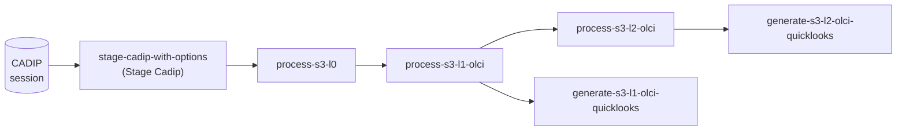

# Sentinel-3 flows

The [Sentinel-3](https://sentinels.copernicus.eu/web/sentinel/missions/sentinel-3) processing chain available in
RS-Python goes from the raw data sessions to the OLCI Level-2 products and their quicklooks:

| Flow | Parameters | Description | Processor |
|---|---|---|---|
| `process-s3-l0` | `session`, `flow_params`, `verbose` | Level-0 processing of a session already staged (see also `process-l0` in [Level-0 flows](level0-flows.md)). Emits the `rs-python.s3-l0.products-ready` event. | `s3_l0` |
| `process-s3-l1-olci` | `flow_params`, `l0_products`, `source_l0_run_id` | OLCI Level-1 processing. The input products are either given in `flow_params.input_products`, or built from the `l0_products` list sent by the Level-0 event (3 `S03OLCL0_` products and 1 `S03NATL0_` product). Emits the `rs-python.s3-l1.products-ready` and `rs-python.s3-l1.quicklook-inputs-ready` events. | `s3_l1olci` |
| `process-s3-l2-olci` | `flow_params`, `input_products` | OLCI Level-2 processing of the `S03OLCEFR` Level-1 products. Emits the `rs-python.s3-l2.quicklook-inputs-ready` event. | `s3_l2olci` |
| `generate-s3-l1-olci-quicklooks` | `owner_id`, `published_items` | Generate an RGB quicklook of each Level-1 product, as a JPEG image and a georeferenced [Cloud Optimized GeoTIFF](https://cogeo.org/), upload them next to the product and add them as `thumbnail` assets of its STAC item. | |
| `generate-s3-l2-olci-quicklooks` | `owner_id`, `published_items` | Same for the Level-2 products. | |

The flows are chained automatically by Prefect automations, see
[Systematic processing](../advanced/systematic-processing.md). They can also be run individually from the Prefect
dashboard.

## Flows based on `process-any`

The OLCI Level-1 and Level-2 processing can also be run with flows that only compute the input products and the
external variables of the processor, then call the generic flow `process-any` (see
[Customise the DPR processing](../advanced/customise-dpr-flow.md#default-settings-of-process-any)). Each processing
has an on-demand flow, run by a user from one product, and a systematic flow, started by an automation from the
event of the product generated by the previous processing (see
[Systematic processing](../advanced/systematic-processing.md#product-events-of-process-any)):

| Flow | Parameters | Description |
|---|---|---|
| `process-s3-l1-olci-ondemand` | `env_args`, `single_input_product` (`item_id`, `collection_name`, `s03olcl0_` by default), `force_systematic`, `olcil0_base_name`, `navl0_base_name` | OLCI Level-1 processing of an `S03OLCL0_` product, with the `s3l1olci-default-setting` settings. |
| `process-s3-l1-olci-systematic` | `payload` | Same, for the product of the `product.S03OLCL0_.generated` event. |
| `process-s3-l2-olci-ondemand` | `env_args`, `single_input_product` (`item_id`, `collection_name`, `s03olcefr` by default), `force_systematic`, `olcefr_base_name` | OLCI Level-2 processing of an `S03OLCEFR` product, with the `s3l2olci-default-setting` settings. |
| `process-s3-l2-olci-systematic` | `payload` | Same, for the product of the `product.S03OLCEFR.generated` event. |

The `force_systematic` parameter runs an on-demand flow as a systematic one: the `workflow` of the run is then
`systematic`, and an event is emitted for each generated product, so that the next processing is started
automatically.

The input products of the OLCI Level-1 processing are searched in the catalog, around the given `S03OLCL0_` product:

| Input of the task table | Product |
|---|---|
| `S3OLCIL0_1` | The given `S03OLCL0_` product. |
| `S3OLCIL0_2`, `S3OLCIL0_3` | The next and the previous `S03OLCL0_` products of the same satellite, when they exist: the latest created products included in the interval of the given product, shifted by its duration. |
| `S3NAVL0_1` | The latest created `S03NATL0_` product of the same satellite included in the interval of the given product. It is searched in the `s03natl0_` collection when the `S03OLCL0_` products are in the `s03olcl0_` collection, otherwise in the same collection as them. |

The prefixes of these names in the task table are given by the `olcil0_base_name` (`S3OLCIL0_`) and
`navl0_base_name` (`S3NAVL0_`) parameters. The external variables of the processor are the `start_datetime` and
`end_datetime` of the given product, and its `satellite` (platform) for the Level-1. The OLCI Level-2 processing has
a single input product, the given `S03OLCEFR` product (`olcefr_base_name`).

The default settings of the Sentinel-3 flows are read from the `s3-processing-default-setting` Prefect variable
(`l0`, `l1` and `l2` sections, plus the `orchestration` section used by the automations), see
[Customise the DPR processing](../advanced/customise-dpr-flow.md#default-settings-of-the-processing-flows).

The task tables of the Sentinel-3 processors are in the
[rs-dpr-service config](https://github.com/RS-PYTHON/rs-dpr-service/tree/develop/config) folder
(`TaskTable_S3_L0_*.json`, `TaskTable_S3_L1OLCI_*.json`, `TaskTable_S3_L2OLCI_*.json`, `TaskTable_S3_L1SLSTR_*.json`).
