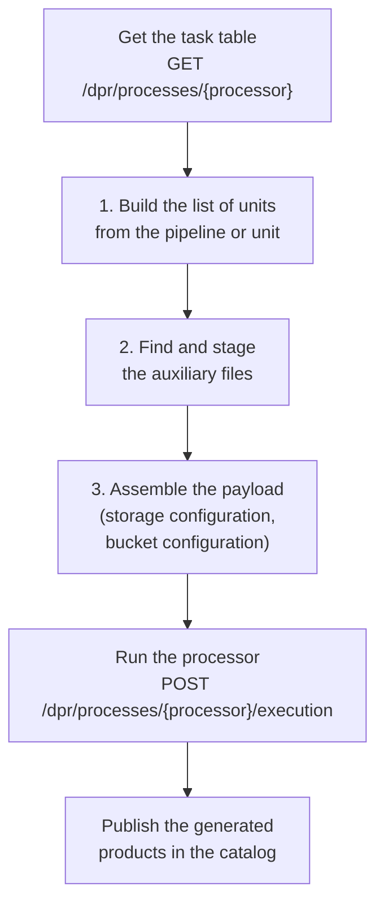

# Task tables and payload file

The DPR processors are run by the generic processing flow, `process-generic`, that doesn't contain any code specific
to a mission or a processing level: everything it needs to know about a processor is read from its **task table**,
and it generates the **payload file** that triggers the processor. This page explains these two files and how the
payload is built. The parameters of `process-generic` are described in
[Customise the DPR processing](../advanced/customise-dpr-flow.md).

## Task table

A [task table](https://cpm.pages.eopf.copernicus.eu/eopf-cpm/main/processor-orchestration-guide/tasktables.html) is
delivered with each DPR processor by the [EOPF](https://eopf.copernicus.eu/) project. It describes the processing
units of the processor, their inputs and outputs, the rules to select their auxiliary data files (ADFs), and the
pipelines that chain the units. The task tables of the processors integrated in RS-Python are in the
[config](https://github.com/RS-PYTHON/rs-dpr-service/tree/develop/config) folder of rs-dpr-service. The flows get
them from the `GET /dpr/processes/{processor}` endpoint.

A task table is validated against the JSON schema
[TaskTable.schema.json](https://github.com/RS-PYTHON/rs-client-libraries/blob/develop/config/TaskTable.schema.json)
before it is used. It contains the following sections:

| Section | Content |
|---|---|
| `tasktable` | Name and version of the task table, and of the specification it follows. |
| `external_variables` | Variables given by the orchestrator, used in the queries, e.g. `start_datetime`, `end_datetime`, `satellite`. |
| `units` | The processing units: name, Python `module`, minimum resources (`resources_min`: Dask workers, CPU, RAM, disk), and the lists of `input_products`, `input_adfs` and `output_products`. Each input or output has a `mode` (`always`, `nrt`, `ntc`, `reprocessing`, `subs`) and a `mandatory` flag. |
| `external_modules` | Optional. The Python modules to load in the processor (`name`, `alias`, `star_import`, `folder`), copied as is to the payload. |
| `io` | The details of each input, ADF and output, either grouped in the `input`, `adfs` and `output` lists, or indexed by product name. Each one has a type (`file`, `folder`, `regex`, `cache`), an `engine` (`cpm_zarr`, `cpm_safe`, `cadu`, `s3_cache`, `fast_zarr`) and optional parameters: `reader_params` for the inputs, `writer_params` for the outputs, `adfs_params` for the ADFs. For the ADFs, the ordered `alternatives` to find them, each one with a `query` and a `timeout_seconds`. |
| `queries` | The named queries used by the alternatives: their parameters and the STAC search request (with a [CQL2](https://docs.ogc.org/is/21-065r2/21-065r2.html) filter) to find the files. |
| `pipelines` | The pipelines: ordered `steps`, each one running a unit, with the origin of its inputs (`pipeline_input` or the output of a previous step) and the target of its outputs (`pipeline_output` or `pipeline_internal`). |

For example, an excerpt of the Sentinel-3 OLCI Level-1 task table:

```json
{
  "external_variables": ["start_datetime", "end_datetime", "satellite"],
  "units": [{
    "name": "OL1Processor",
    "module": "s3olci.s3_ol1.ol1_processor",
    "input_products": [{"name": "S3OLCIL0_1", "mode": "always", "mandatory": true}, "..."],
    "input_adfs": [
      {"name": "FRO", "mode": "always", "mandatory": true},
      {"name": "ECMWF", "mode": "nrt", "mandatory": true},
      {"name": "ECMWA", "mode": "ntc", "mandatory": true}, "..."],
    "output_products": [{"name": "S03OLCEFR", "mode": "always", "mandatory": false}, "..."]
  }],
  "io": {
    "input": [{"name": "S3OLCIL0_1", "type": "file", "engine": "cpm_zarr"}, "..."],
    "adfs": [{
      "name": "FRO",
      "type": "file",
      "engine": "cpm_zarr",
      "alternatives": [
        {"order": 1, "timeout_seconds": 180, "query": {"name": "LatestValCover", "parameters": {
          "product_type": "AX___FRO_AX", "satellite": "{external_variable.satellite}",
          "start_datetime": "{external_variable.start_datetime}", "end_datetime": "{external_variable.end_datetime}",
          "dTa": 8.8, "dTb": 8.8}}},
        {"order": 2, "timeout_seconds": 180, "query": {"name": "LatestValCover", "parameters": {
          "product_type": "AX___FPO_AX", "...": "..."}}}
      ]
    }, "..."],
    "output": [{"name": "S03OLCEFR", "type": "file", "engine": "cpm_zarr"}, "..."]
  },
  "queries": [{
    "name": "LatestValCover",
    "parameters": ["product_type", "satellite", "start_datetime", "end_datetime", "dTa", "dTb"],
    "stac": {
      "filter": {"op": "and", "args": [
        {"op": "=", "args": [{"property": "product:type"}, "{product_type}"]},
        {"op": "=", "args": [{"property": "platform"}, "{satellite}"]},
        {"op": "t_contains", "args": [
          {"interval": [{"property": "start_datetime"}, {"property": "end_datetime"}]},
          {"interval": [{"op": "-", "args": ["{start_datetime}", "{dTa}"]},
                        {"op": "+", "args": ["{end_datetime}", "{dTb}"]}]}]}]},
      "sortby": [{"field": "created", "direction": "desc"}],
      "limit": 1
    }
  }],
  "pipelines": [{
    "name": "ol1_eo",
    "steps": [{"unit_name": "OL1Processor", "step_id": 1,
      "input_products": {"S3OLCIL0_1": "pipeline_input", "...": "..."},
      "output_products": {"S03OLCEFR": "pipeline_output", "S03OLCERR": "pipeline_output"}}]
  }]
}
```

## Payload file

The payload file is the [YAML file that triggers an EOPF processor](https://cpm.pages.eopf.copernicus.eu/eopf-cpm/main/processor-orchestration-guide/triggering-usage.html).
Its main sections are:

| Section | Content |
|---|---|
| `general_configuration` | General options: the logging levels (`logging__progress_level`, `logging__level`, set from `env.logging_level`), the Zarr format of the products (`zarr__format`, 3), `triggering__temporary_shared`, `dask_utils__timeout`, and the options of the staging of the S3 outputs (`triggering__stage_s3_*`, see [Parameters of `process-generic`](../advanced/customise-dpr-flow.md#parameters-of-process-generic)). |
| `external_modules` | The Python modules loaded by the processor, copied from the task table (optional). |
| `workflow` | The processing units to run, in order: module, class, inputs, ADFs and outputs of each one. |
| `io` | The location and format of the `input_products`, `adfs` and `output_products`, sorted by `id`: S3 paths with their credentials, shared or local disk paths. Each input has an `engine` and its `reader_params`, each output an `engine` and its `writer_params`, each ADF its `adf_params`. |
| `context_managers`, `dask_config` | The Dask cluster to use and its configuration (completed by rs-dpr-service). |
| `logging`, `config`, `secret`, `eoqc` | Optional configuration files and quality control. |

```yaml
general_configuration:
  logging__progress_level: INFO
  logging__level: INFO
  triggering__use_basic_logging: true
  zarr__format: 3
  # ...
workflow:
- name: OL1Processor.1
  active: true
  module: s3olci.s3_ol1.ol1_processor
  processing_unit: OL1Processor
  inputs:
    S3OLCIL0_1: S3OLCIL0_1
    # ...
  adfs:
    FRO: FRO
    # ...
  outputs:
    S03OLCEFR: S03OLCEFR
io:
  input_products:
  - id: S3OLCIL0_1
    path: s3://<bucket>/<owner>/<collection>/<product>.zarr
    engine: cpm_zarr
    reader_params:
      storage_options: {key: "...", secret: "...", client_kwargs: {endpoint_url: "...", region_name: "..."}}
  adfs:
  - id: FRO
    path: s3://<bucket>/<owner>/<aux-collection>/<adf>.zarr
    adf_params: {}
  output_products:
  - id: S03OLCEFR
    path: s3://<bucket>/<owner>/<output-collection>/<uuid>
    type: file
    engine: cpm_zarr
    writer_params:
      mode: w
      storage_options: {key: "...", secret: "...", client_kwargs: {endpoint_url: "...", region_name: "..."}}
```

The `mode` of the `writer_params` is `w` by default; it and the other parameters given in the `writer_params` of the
task table are copied to the payload.

For the Sentinel-1 and Sentinel-3 Level-0 processors, the `logging` section lists the logging configuration file of the
Level-0 Dask worker image, `triggering__use_basic_logging` is `false`, and an `adf_l0cfg` ADF (the configuration file
of the Level-0 processor, in the same image) is added to the `io` section and to each step of the workflow.

The payload is published as the `dpr-payload` [Prefect artifact](index.md#artifacts) of each run (without the
secrets), and the task table as the `dpr-task-table` artifact.

## How the payload is built



### 1. Build the list of units

- **Pipeline mode** (the usual case, `pipeline` parameter): the units are taken from the `steps` of the pipeline,
  ordered by `step_id`, with their `module` from the `units` section. The origin of each input is either
  `pipeline_input` (an input product given to the flow) or the output of a previous step
  (`<unit>.<step_id>.<output>`), and the target of each output is `pipeline_output` (a product published in the
  catalog) or `pipeline_internal` (an intermediate product).
- **Unit mode** (for advanced users, `unit` parameter): only the given unit is run, with all its inputs given to
  the flow and all its outputs published.

In both modes, the inputs, ADFs and outputs are filtered with their `mode`: the ones with mode `always` are kept,
and the other ones only if their mode is in the `processing_mode` parameter of the flow (e.g. `nrt` or `ntc`).
Their details are read from the `io` section. The external variables (`{external_variable.start_datetime}`...) are
replaced by the values of the flow parameters in the whole task table, before the units are built.

### 2. Find and stage the auxiliary files

For each ADF of each unit, the flow tries its `alternatives` in their `order`:

1. it gets the query of the alternative from the `queries` section and builds the STAC request, by replacing the
   parameters in the CQL2 filter,
2. it chooses where to search the files and in which catalog collection to stage them, from the
   `auxiliary_product_to_collection_identifier` parameter of the flow (see
   [Customise the DPR processing](../advanced/customise-dpr-flow.md#auxiliary-files)),
3. it searches the files in the source (AUXIP, catalog, PRIP, CDSE...) and stages the new ones in the catalog, with
   the `stage-aux-cql2` flow, within `timeout_seconds`,
4. if at least one file is found, it stops, otherwise it tries the next alternative.

At the end of this step, the S3 path of each ADF is known.

### 3. Assemble the payload

The payload is assembled from:

| Information | Source |
|---|---|
| Units, their modules, inputs, ADFs and outputs | The task table, see step 1. |
| Paths of the input products | The STAC items of the input products given to the flow (`input_products` parameter), searched in the catalog. |
| Paths of the ADFs | Step 2. |
| Paths of the output products | The bucket given by the [bucket configuration](https://github.com/RS-PYTHON/rs-documentation/blob/develop/docs/administration/update-rs-server.md#object-storage-buckets-and-data-lifecycle) for the owner, collection and product type of each output (`generated_product_to_collection_identifier` parameter). |
| Storage of each input, ADF and output (S3, shared disk, local disk) and the credentials | The [storage configuration](../advanced/customise-dpr-flow.md#storage-configuration). |
| Logging level, processing options | The flow parameters. |

The payload is written in the `<absolute_path>/<owner>/<timestamp>` folder of the first `shared_disk` storage of the
[storage configuration](../advanced/customise-dpr-flow.md#storage-configuration) whose `opening_mode` is
`CREATE_OVERWRITE` (the only use of this option): this disk is mounted both on the Prefect workers and on the Dask workers. Then the processor is
run by rs-dpr-service on the Dask cluster, and the payload file is deleted at the end of the run.
When it is completed, the flow creates the STAC items of the generated products, with `derived_from` links to their
inputs and ADFs, and publishes them in the catalog collections given by the
`generated_product_to_collection_identifier` parameter.

## Auxiliary data selection policies

The queries of the task tables implement the input retrieval policies defined by ESA for the Copernicus processors.
The ADFs cover a validity period `[start_datetime, end_datetime]`, and each query compares it with the time
interval of the processed data `[t0, t1]`, possibly enlarged by `dTa` before and `dTb` after it (in seconds):
`[t0 - dTa, t1 + dTb]`. They are translated into STAC searches with CQL2 filters, the temporal operators being
those of the [CQL2 specification](https://docs.ogc.org/is/21-065r2/21-065r2.html#temporal-functions):

| Policy | Description | STAC search |
|---|---|---|
| `ValCover` | All the files that entirely cover the interval. | `t_contains(interval(start_datetime, end_datetime), interval(t0 - dTa, t1 + dTb))` |
| `LatestValCover` | The most recent file (latest creation date) that entirely covers the interval. | `ValCover` filter, `sortby=-created`, `limit=1` |
| `ValIntersect` | All the files that partly cover the interval. | `t_intersects(interval(start_datetime, end_datetime), interval(t0 - dTa, t1 + dTb))` |
| `LatestValIntersect` | The most recent file that partly covers the interval. | `ValIntersect` filter, `sortby=-created`, `limit=1` |
| `LatestValidity` | The most recent file of the product type, whatever its validity. | `sortby=-created`, `limit=1` |
| `LatestValCoverNewestValidity` | `LatestValCover`, or `LatestValidity` if no file is found. | Two alternatives of the task table. |
| `ByItemId` | A file given by its identifier. | `id = '<identifier>'` |

The queries also filter the product type (`product:type`) and, when relevant, the satellite (`platform`): some task
tables define variants of the same policy with or without the satellite filter. The policies of the ESA
specification that select the file whose validity is the closest to a date (e.g. `ClosestStartValidity`,
`BestCenteredCover`, `LargestOverlap`) have no equivalent in the standard CQL2 temporal functions, and are not
supported by the catalog.

Other policies can be added in the task tables with the same mechanism, as long as they can be expressed as a STAC
search.
