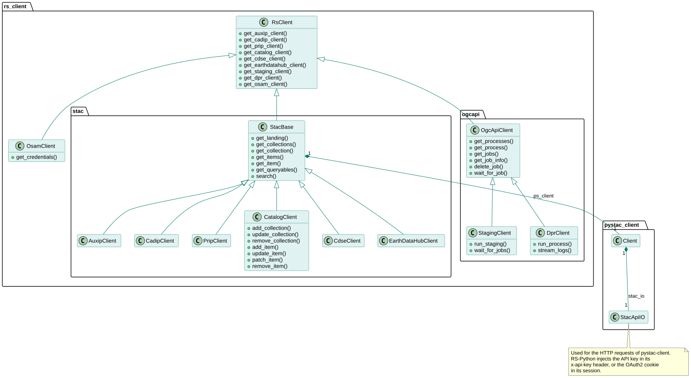

# rs-client-libraries

**rs-client-libraries** is the Python library of RS-Python for the users and the flow developers. It contains three
packages:

| Package | Content | Documentation |
|---|---|---|
| `rs_client` | Clients to call the RS-Python services: external data sources, catalog, staging, DPR processing, OSAM. | This page, [Create a custom flow](advanced/custom-flow.md) |
| `rs_workflows` | The [Prefect](https://www.prefect.io/) flows delivered with RS-Python: search, staging, processing, operations. | [Prefect flows](flows/index.md) |
| `rs_common` | Common utilities: logging, [OpenTelemetry](https://opentelemetry.io/) instrumentation, Prefect blocks, S3 access, model classes and enums. | [Python API documentation](https://github.com/RS-PYTHON/rs-documentation/blob/develop/docs/developers/python-api.md) |

| Link | |
|---|---|
| Source code | <https://github.com/RS-PYTHON/rs-client-libraries> |
| Python package | <https://pypi.org/project/rs-client-libraries/> |
| Python API documentation | `rs_client`, `rs_common` and `rs_workflows` modules of the [Python API documentation](https://github.com/RS-PYTHON/rs-documentation/blob/develop/docs/developers/python-api.md) |

## Installation

There are two ways to use the library:

1. From your [JupyterHub](https://github.com/RS-PYTHON/rs-documentation/blob/develop/docs/services/virtual-environment/jupyterhub.md)
   session on the platform, where the latest version is already installed, with the environment variables needed
   to call the services.
2. In your own Python environment:

    ```shell
    pip install rs-client-libraries
    opentelemetry-bootstrap -a install  # install the OpenTelemetry instrumentation of the dependencies
    ```

    Then set the `RSPY_WEBSITE` environment variable to the URL of the services, e.g.
    `https://rspy.ops.rs-python.eu`, and `RSPY_APIKEY` to your [API key](https://github.com/RS-PYTHON/rs-documentation/blob/develop/docs/getting-started/user-rights.md#api-keys).

## Architecture of rs_client



- **RsClient** is the base class. It holds the URL of the services, the authentication information (API key, or
  OAuth2 session cookie read from the `RSPY_OAUTH2_COOKIE` environment variable) and the owner identifier used for
  the catalog. It creates the instances of the child classes with the same attributes: `get_cadip_client()`,
  `get_catalog_client()`...
- **StacBase** and its child classes call the [STAC APIs](https://github.com/radiantearth/stac-api-spec). They wrap
  a [pystac-client](https://pystac-client.readthedocs.io/) `Client`, whose `StacApiIO` instance sends the HTTP
  requests with the API key in the `x-api-key` header. They add error handling and caching to pystac-client:
    - **CadipClient**, **AuxipClient** and **PripClient** call the [external data sources](https://github.com/RS-PYTHON/rs-server/blob/develop/docs/doc/users/external-data-sources.md),
    - **CatalogClient** calls the [catalog](https://github.com/RS-PYTHON/rs-server/blob/develop/docs/doc/users/catalog.md)
      and adds the write operations (collections and items creation, update, deletion) that pystac-client doesn't
      provide,
    - **CdseClient** and **EarthDataHubClient** call the public STAC APIs of the
      [Copernicus Data Space Ecosystem](https://dataspace.copernicus.eu/) and of the
      [Destination Earth](https://destination-earth.eu/) [EarthDataHub](https://earthdatahub.destine.eu/).
- **OgcApiClient** and its child classes call the [OGC API - Processes](https://ogcapi.ogc.org/processes/)
  services, and validate the requests and responses with the OGC schemas:
    - **StagingClient** calls the [staging](https://github.com/RS-PYTHON/rs-server/blob/develop/docs/doc/users/staging.md),
    - **DprClient** calls the [DPR processing service](https://github.com/RS-PYTHON/rs-dpr-service/blob/develop/docs/doc/index.md).
- **OsamClient** gets your object storage credentials from [OSAM](https://github.com/RS-PYTHON/rs-server/blob/develop/docs/doc/users/osam.md).

In local mode (`RSPY_LOCAL_MODE=1`), no authentication is needed and the URL of each service is read from the
`RSPY_HOST_<SERVICE>` environment variables.

## Examples

```python
import os
from rs_client.rs_client import RsClient

# The API key is mandatory in cluster mode. Use the OAuth2 cookie only from interactive notebooks,
# because it has a short lifespan.
rs_client = RsClient(
    rs_server_href=os.environ["RSPY_WEBSITE"],
    rs_server_api_key=os.environ["RSPY_APIKEY"],
    owner_id=None,  # default: the owner of the API key
)

# Search the sessions of a CADIP station
cadip_client = rs_client.get_cadip_client()
for collection in cadip_client.get_collections():
    print(collection.id)
sessions = cadip_client.search(collections=["sgs"], timestamp="2026-08-07T00:00:00Z/2026-08-08T00:00:00Z")

# Stage them into one of your catalog collections, and wait for the jobs to finish
staging_client = rs_client.get_staging_client()
jobs = staging_client.run_staging(sessions.to_dict(), "my-sessions")
staging_client.wait_for_jobs(jobs)

# Read your catalog collection
catalog_client = rs_client.get_catalog_client()
items = list(catalog_client.get_items("my-sessions"))

# Get your object storage credentials
credentials = await rs_client.get_osam_client().get_credentials()
```

More examples are given in [Create a custom flow](advanced/custom-flow.md), in
[Browse products](https://github.com/RS-PYTHON/rs-documentation/blob/develop/docs/services/browse-products.md#with-python),
and in the [rs-demo](https://github.com/RS-PYTHON/rs-demo) notebooks.
