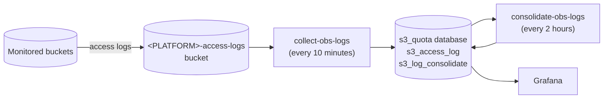

# Object storage quota monitoring

The quota monitoring collects the access logs of the object storage buckets, to follow the read, write and download
operations of each user on each bucket over time, e.g. to control the costs. It relies on the
[server access logging](https://help.ovhcloud.com/csm/fr-public-cloud-storage-s3-server-access-logging?id=kb_article_view&sysparm_article=KB0056623)
of the object storage provider, and on [operation flows](../flows/common-flows.md#operation-flows) that load the logs
into a PostgreSQL database displayed by Grafana.



## Set up

In the following, `<PLATFORM>` is the name of your platform, e.g. `rspython-ops`.

### Object storage

1. Create the `<PLATFORM>-access-logs` bucket.
2. Enable the server access logging on each bucket to monitor (the buckets that host the products), with this
   configuration:

    ```json
    {
      "LoggingEnabled": {
        "TargetBucket": "<PLATFORM>-access-logs",
        "TargetPrefix": "prip/"
      }
    }
    ```

3. Create an object storage account with the description
   `Quota monitoring : access to the bucket <PLATFORM>-access-logs`, and give it the administration rights on the
   `<PLATFORM>-access-logs` bucket.

### Keycloak

Create the `operator-quota` account, with the `RS-JUPYTER-USER` group.

### Prefect block

Log in to JupyterHub with the `operator-quota` account, create its Prefect block (see
[Set up your environment](https://github.com/RS-PYTHON/rs-documentation/blob/develop/docs/getting-started/setup-environment.md)),
then add the credentials of the `s3_quota` database (from the `rs_s3quotamonitoring` inventory variables) and of the
`<PLATFORM>-access-logs` bucket:

```python
import getpass
import os
from rs_common.prefect_utils import BLOCK_NAME_ENV_USER, format_env_user, update_prefect_block

await update_prefect_block(
    format_env_user(BLOCK_NAME_ENV_USER, os.environ["JUPYTERHUB_USER"]),
    {
        "POSTGRES_QUOTA_USER": "<database user>",
        "POSTGRES_QUOTA_PASSWORD": getpass.getpass("Password of the s3_quota database: "),
        "S3_QUOTA_REGION": os.environ["S3_REGION"],
        "S3_QUOTA_ENDPOINT": os.environ["S3_ENDPOINT"],
        "S3_QUOTA_ACCESSKEY": getpass.getpass("Access key of the <PLATFORM>-access-logs bucket: "),
        "S3_QUOTA_SECRETKEY": getpass.getpass("Secret key of the <PLATFORM>-access-logs bucket: "),
    },
)
```

### Prefect flows

With the `operator-quota` owner (the default `env` of the flows):

1. run `initialize-obs-db` once, to create the database tables,
2. schedule `collect-obs-logs` (`Collect OBS Logs` deployment) every 10 minutes, to load the new logs into the
   `s3_access_log` table,
3. schedule `consolidate-obs-logs` (`Consolidate OBS Logs` deployment) every 2 hours, to consolidate the old logs
   per user, bucket and hour into the `s3_log_consolidate` table and purge them.

### Grafana

Build a dashboard with the `Postgres-s3quotamonitoring` data source, showing the read, write and download
operations per user and per bucket over time, from the `s3_access_log` and `s3_log_consolidate` tables of the
`s3_quota` database.
